# Pastel UI

## One look for your whole home.

**104 coordinated Home Assistant cards in one installation.** Bring lights, climate, security, energy and everyday devices into the same calm visual language. Connect the entities you already have, choose your colours and make the controls yours.

[English](#english) · [Italiano](#italiano) · [Explore 12 cards](#explore-the-collection) · [All 104 cards](docs/catalog.md) · [Installation guide](docs/installation.md) · [Changelog](CHANGELOG.md)

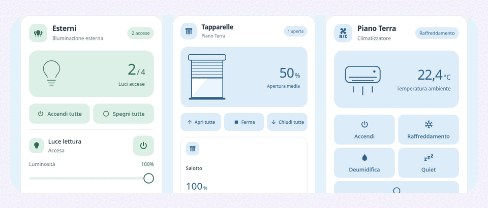

> The previews use fictional Home Assistant data. They show Pastel UI cards, not a preconfigured dashboard or devices that the project installs.

## English

### A dashboard that feels like one product

Pastel UI gives different parts of your home a consistent layout: readable states, soft colours and controls sized for touch. Cards read the Home Assistant entities you choose, so their values update when those entities change elsewhere. The collection includes focused cards for familiar devices and flexible cards for script-driven or unusual setups.

- **Your home, your configuration.** Pick entities, names, palettes and actions in the available visual editors; advanced options are documented for YAML.
- **Made for phones.** Large illustrations and touch targets keep common actions easy to find.
- **One collection.** Explore 104 card types without installing a separate repository for each device.

### Explore the collection

A selection of 12 cards shows the range of Pastel UI. Open a card's guide for its configuration and an Italian translation, or [browse the full catalogue](docs/catalog.md).

#### Home & climate

| | |
|---|---|
| [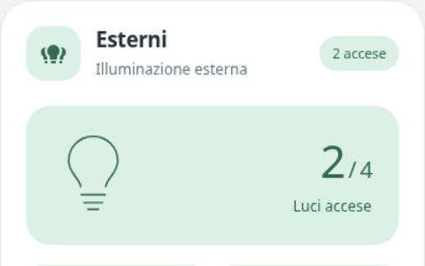](docs/cards/lights.md) [**Lights**](docs/cards/lights.md) | [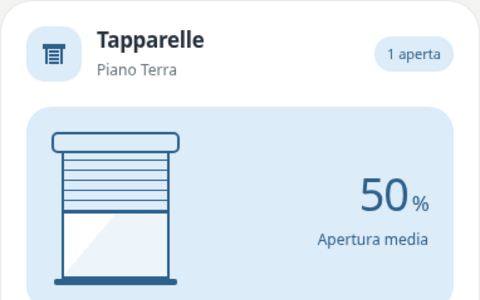](docs/cards/covers.md) [**Covers**](docs/cards/covers.md) |
| [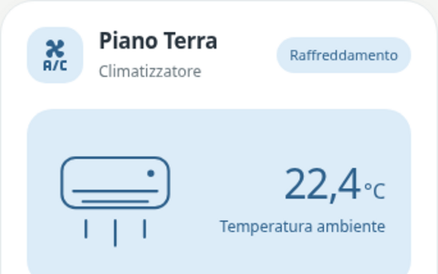](docs/cards/script-climate.md) [**Climate AC**](docs/cards/script-climate.md) | [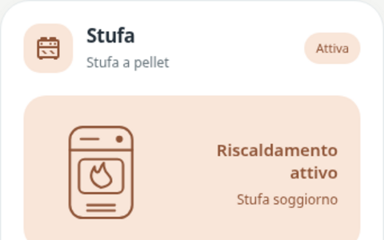](docs/cards/stove.md) [**Pellet Stove**](docs/cards/stove.md) |

#### Security & sensors

| | |
|---|---|
| [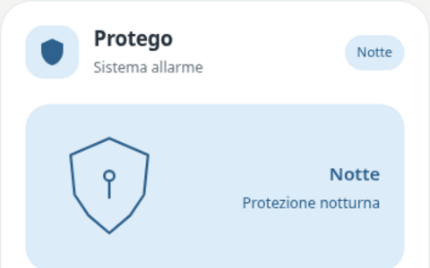](docs/cards/security.md) [**Alarm**](docs/cards/security.md) | [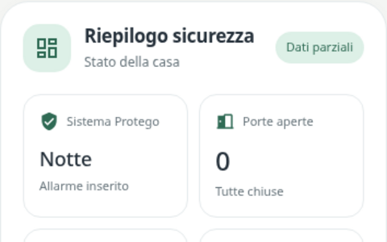](docs/cards/security.md) [**Security Overview**](docs/cards/security.md) |
| [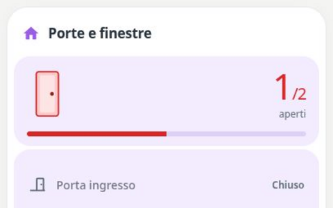](docs/cards/doors-windows.md) [**Doors & Windows**](docs/cards/doors-windows.md) | [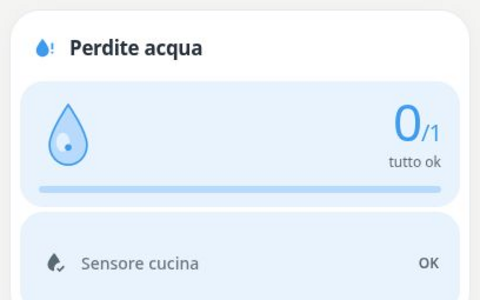](docs/cards/water-leak.md) [**Water Leak**](docs/cards/water-leak.md) |

#### Everyday

| | |
|---|---|
| [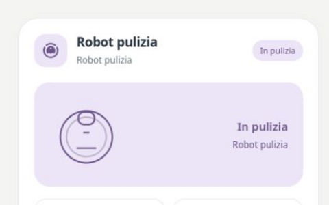](docs/cards/robot.md) [**Robot Vacuum**](docs/cards/robot.md) | [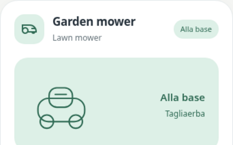](docs/cards/lawn-mower.md) [**Lawn Mower**](docs/cards/lawn-mower.md) |
| [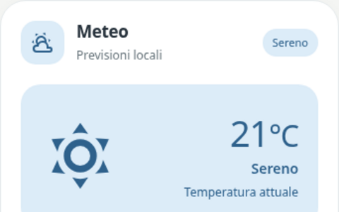](docs/cards/weather.md) [**Weather**](docs/cards/weather.md) | [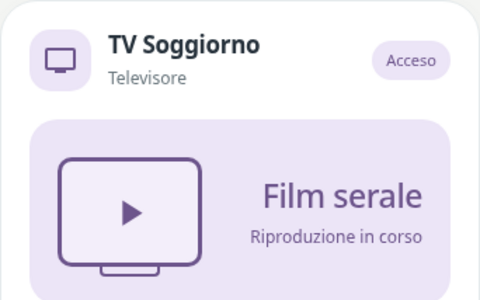](docs/cards/tv.md) [**TV**](docs/cards/tv.md) |

[**See all 104 cards →**](docs/catalog.md)

### From installation to your first card

1. **Find Pastel UI.** In Home Assistant 2026.11 or newer, open **Settings → Marketplace** and search for **Pastel UI**. On older installations, search in **HACS → Dashboards**. If it has not appeared in search yet, the [installation guide](docs/installation.md) explains how to add the repository manually.
2. **Install the latest stable release.** Home Assistant should register one JavaScript module resource for Pastel UI.
3. **Add a card to your dashboard.** Search for **Pastel** in the card picker, select a card and replace its demo entities with your own.

[**Step-by-step installation, migration and troubleshooting →**](docs/installation.md)

### Make it yours

**Climate AC** can expose any number of script buttons. **Pellet Stove** can show values from your helpers while scripts handle its controls. **Alarm** can use native alarm-panel actions or scripts. **Cameras** can display the camera entities you select in a grid or list. See the [configuration guide](docs/configuration.md) and the individual card guides for details.

Pastel UI supplies dashboard cards; it does not add devices, integrations, helpers or automations. Available measurements and commands depend on the integrations you use. Some advanced options require YAML. Visual-editor labels are currently mostly in Italian; installation and guides are available in English and Italian.

### Help shape Pastel UI

**Requests for new cards and improvements are welcome.** [Open an issue](https://github.com/Angelofsin666/pastel-ui/issues) with the device, integration and behaviour you have in mind, or read [how to contribute](CONTRIBUTING.md). If the collection helps you, a [GitHub star](https://github.com/Angelofsin666/pastel-ui) helps other people find it.

Pastel UI was developed with AI assistance. The maintainer is responsible for design decisions, review and publication. Read the [testing and compatibility notes](docs/testing.md) for the project's verified scope. Pastel UI is community-maintained and is not affiliated with or endorsed by Home Assistant.

## Italiano

### Un solo stile per tutta la casa

**104 card coordinate per Home Assistant, con un'unica installazione.** Luci, clima, sicurezza, energia e dispositivi di ogni giorno condividono uno stile leggibile e coerente. Collega le entità che hai già, scegli i colori e configura i comandi in base al tuo impianto.

- **La tua casa, le tue impostazioni.** Negli editor visuali disponibili puoi scegliere entità, nomi, palette e azioni; le opzioni avanzate sono documentate anche in YAML.
- **Pensate per lo smartphone.** Disegni grandi e pulsanti comodi rendono immediati i comandi più usati.
- **Una sola raccolta.** Puoi esplorare 104 tipi di card senza installare una repository diversa per ogni dispositivo.

### Esplora le card

La [galleria di 12 card](#explore-the-collection) qui sopra mostra esempi per casa e clima, sicurezza e dispositivi quotidiani. Le immagini usano dati fittizi. Apri la guida di ogni card per configurarla, oppure consulta il [catalogo completo delle 104 card](docs/catalog.md).

### Dall'installazione alla prima card

1. **Trova Pastel UI.** In Home Assistant 2026.11 o successivo apri **Impostazioni → Marketplace** e cerca **Pastel UI**. Nelle versioni precedenti cerca in **HACS → Dashboard**. Se non compare ancora nei risultati, la [guida all'installazione](docs/installation.md) spiega come aggiungere manualmente la repository.
2. **Installa l'ultima versione stabile.** Home Assistant dovrebbe registrare una sola risorsa JavaScript Module per Pastel UI.
3. **Aggiungi una card alla dashboard.** Cerca **Pastel** nel selettore delle card, scegli la card e sostituisci le entità dimostrative con le tue.

[**Installazione dettagliata, migrazione e risoluzione problemi →**](docs/installation.md)

### Personalizzala

**Climate AC** accetta tutti i pulsanti script di cui hai bisogno. **Pellet Stove** può mostrare i valori dei tuoi aiutanti e usare script per i comandi. **Alarm** supporta azioni native del pannello o script. **Cameras** raccoglie le telecamere che selezioni in una griglia o in un elenco. Trovi i dettagli nella [guida alla configurazione](docs/configuration.md) e nelle guide delle singole card.

Pastel UI fornisce card per la dashboard; non crea dispositivi, integrazioni, aiutanti o automazioni. Misure e comandi disponibili dipendono dalle integrazioni usate. Alcune opzioni avanzate richiedono YAML. Le etichette degli editor visuali sono attualmente soprattutto in italiano; installazione e guide sono disponibili in entrambe le lingue.

### Facciamola crescere insieme

**Sono benvenute richieste di nuove card e miglioramenti.** [Apri una issue](https://github.com/Angelofsin666/pastel-ui/issues) indicando il dispositivo, l'integrazione e il comportamento desiderato, oppure leggi [come contribuire](CONTRIBUTING.md). Se Pastel UI ti è utile, una [stella su GitHub](https://github.com/Angelofsin666/pastel-ui) aiuta altre persone a scoprirla.

Pastel UI è stata sviluppata con l'aiuto di strumenti di IA. Il manutentore è responsabile delle scelte di design, della revisione e della pubblicazione. Le [note sui test e sulla compatibilità](docs/testing.md) chiariscono cosa è stato verificato. Pastel UI è un progetto della comunità e non è affiliata né approvata da Home Assistant.
