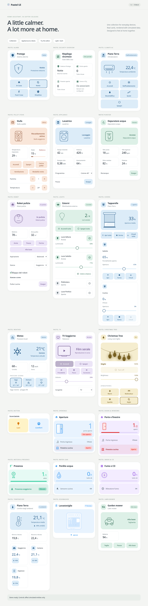
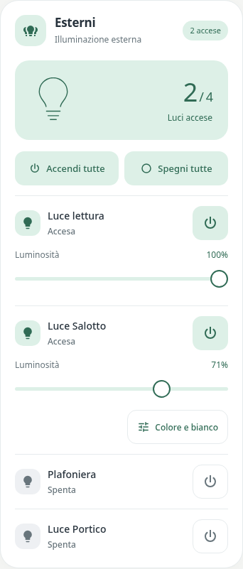
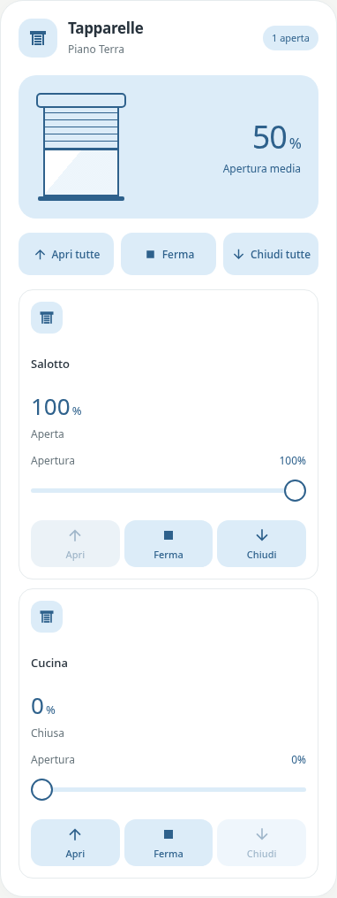
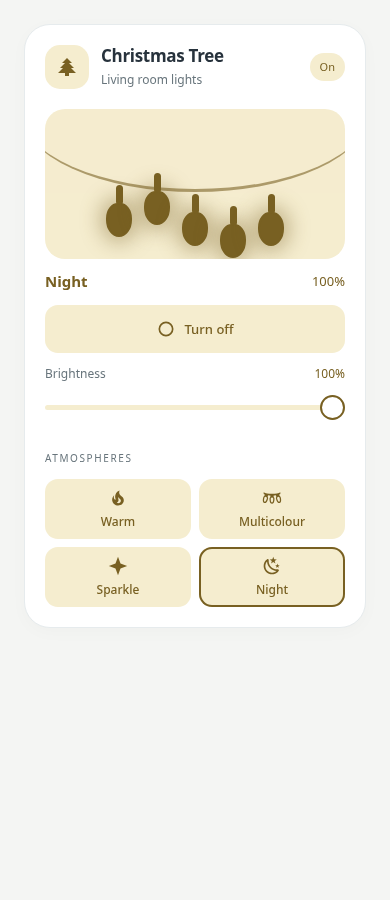

# Pastel UI

**One HACS download. 95 coordinated Home Assistant dashboard cards. Your entities, your colours, your controls.**

[English](#english) · [Italiano](#italiano) · [Gallery](docs/catalog.md) · [Installation](docs/installation.md) · [Configuration](docs/configuration.md) · [Release notes](CHANGELOG.md)

| Mobile lighting | Roller shutters | Christmas garland |
|---|---|---|
|  |  |  |

## English

### A dashboard that feels like one product

Pastel UI brings lights, covers, climate, security, appliances and everyday sensors into a consistent visual language: soft colour, clear state, generous touch targets and layouts made for phones. Choose the entities you already have; the cards do not create devices, helpers or automations. Actions use Home Assistant services and the state displayed comes from Home Assistant, including changes made elsewhere.

### Explore the 95 cards

| Home & climate | Security & sensors | Entertainment & seasonal |
|---|---|---|
| [Lights](docs/cards/lights.md) · [Covers](docs/cards/covers.md) · [Awning & Curtains](docs/cards/fabric-covers.md) · [Climate AC](docs/cards/script-climate.md) · [Thermostat](docs/cards/thermostat.md) · [Pellet Stove](docs/cards/stove.md) · [Temperature](docs/cards/temp.md) | [Alarm and Security Overview](docs/cards/security.md) · [Openings](docs/cards/openings.md) · [Doors & Windows](docs/cards/doors-windows.md) · [Motion & Presence](docs/cards/motion-presence.md) · [Water Leak](docs/cards/water-leak.md) · [Smoke & CO](docs/cards/smoke-co.md) | [Weather](docs/cards/weather.md) · [TV](docs/cards/tv.md) · [Christmas Tree](docs/cards/christmas-tree.md) |
| [Appliance](docs/cards/appliance.md) · [Robot](docs/cards/robot.md) · [Dishwasher](docs/cards/dishwasher.md) · [Lawn Mower](docs/cards/lawn-mower.md) | [Button](docs/cards/button.md) | |

The [gallery](docs/catalog.md) shows every card with fictional example entities. Appliance covers multiple device profiles, including a water purifier, without adding another card type.

**New in 1.8:** [Humidifier, Wine Cellar, Water Softener, Sauna, Electric Fireplace, Parcel Box, Smart Scale, Compost Bin, Aroma Diffuser and Bird Feeder](docs/cards/equipment.md) add ten distinct large illustrations and phone-sized controls. Choose your own entities and actions; Bird Feeder can also open any selected Home Assistant camera.

**New in 1.7:** [Air Purifier, Air Multiplier, Ice Maker, Bread Maker, Toaster, Smart Toothbrush, Smart Mirror and Smart Toilet](docs/cards/equipment.md) add eight full-size device cards. The air cards can read and control a selected native `fan` entity, while scripts handle device-specific modes.

**New in 1.6:** [Awning and Curtains](docs/cards/fabric-covers.md) move their large fabric illustrations with the real cover position or a chosen percentage sensor. Nineteen [new equipment cards](docs/cards/equipment.md) cover access, comfort, garden, utilities and energy. All 21 have editable colours, readings and commands.

**New in 1.5:** [Fan Heater and Infrared Panel](docs/cards/equipment.md) bring room temperature, target and power readings together with configurable power, temperature and mode commands. Doorbell controls are larger and easier to tap on phones.

**New in 1.4:** [UPS, Home Network, Electric Car, Aquarium, Greenhouse, Mailbox, Kitchen Robot and Waste Collection](docs/cards/equipment.md) join a [native Thermostat](docs/cards/thermostat.md). Waste Collection accepts calendar, sensor, input select or boolean entities; the thermostat adapts to the modes and temperature limits of your chosen `climate` entity.

**New in 1.3.1:** [Pellet Stove](docs/cards/stove.md) can now show a selected `counter` helper as “Sacchi disponibili”; the card only reads the helper, so your refill automation remains in Home Assistant.

**New in 1.3:** [Garage & Gate, Doorbell, Smart Lock, Air Quality and Water Safety](docs/cards/equipment.md) add native controls, camera selection and leak monitoring. The garage control is labelled “Basculante” by default, and Doorbell accepts any `camera` entity.

**New in 1.2:** [3D Printer, Printer, Rainwater Tank, Ventilation, Range Hood, Litter Robot, Pet Bowls, Chicken Feeder, Irrigation, Solar and Home Battery](docs/cards/equipment.md) add eleven specialist cards. Irrigation supports any number of individually monitored zones.

**New in 1.1:** [Pool, Sump Pumps, Water Booster, Coffee Machine, Air Fryer, Boiler, Hot Water, EV Charger and Pool Robot](docs/cards/equipment.md) have dedicated visuals, searchable entity fields and configurable actions. Sump Pumps is designed for basement flood-prevention equipment.

### Make it yours

Visual editors let you select relevant Home Assistant entities, rename cards and controls, pick palettes, and configure the available options. Script-driven cards are particularly flexible: **Climate AC** can expose any number of script buttons; **Pellet Stove** combines script controls with helper-backed temperature and flame values; **Alarm** supports native panel commands or scripts; **Christmas Tree** accepts any number of script or scene atmospheres. The garland reads its state from your chosen light or switch, supports brightness when the light does, and can highlight an atmosphere through a chosen helper. The examples never point to a personal installation.

A device's integration still decides which commands and measurements exist. Some advanced configuration uses YAML. Card labels in the current visual editors are primarily Italian; the installation and guides are bilingual.

### Install in HACS

Pastel UI is currently a **custom HACS Dashboard repository**. It is not built into Home Assistant or included in HACS by default.

1. Install [HACS](https://hacs.xyz/) if needed. Open the blue button above, or add `https://github.com/Angelofsin666/pastel-ui` under HACS custom repositories, category **Dashboard**.
2. Download the latest stable release. Confirm that Home Assistant has one JavaScript module resource: `/hacsfiles/pastel-ui/pastel-ui.js`.
3. Reload the dashboard, add a Pastel card from the picker, then choose **your** entities in its editor.

If you used standalone Pastel cards, read the [migration guide](docs/migration.md) before removing their old resources. Manual installation, cache troubleshooting and resource details are in the [installation guide](docs/installation.md).

### Help shape Pastel UI

**Card requests, design suggestions, integration reports and fixes are welcome.** [Open an issue](https://github.com/Angelofsin666/pastel-ui/issues) describing the device, integration and desired behaviour; please remove private entity IDs, credentials and addresses. [Contributions](CONTRIBUTING.md) are welcome too. If Pastel UI makes your dashboard better, a [GitHub star](https://github.com/Angelofsin666/pastel-ui) helps others discover it.

Pastel UI was developed with assistance from AI tools. Design decisions, code review and publication remain the maintainer's responsibility. The [test and compatibility notes](docs/testing.md) describe what has and has not been verified. The project is community-maintained and is not affiliated with or endorsed by Home Assistant.

## Italiano

### Una dashboard che sembra un unico prodotto

Pastel UI riunisce luci, tapparelle, clima, sicurezza, elettrodomestici e sensori in uno stile coerente: colori tenui, stati leggibili, comandi comodi sul telefono. Scegli le entità già presenti nel tuo Home Assistant; le card non creano dispositivi, aiutanti o automazioni. I comandi usano i servizi di Home Assistant e i valori mostrati seguono le entità, anche quando cambiano altrove.

### Scopri le 95 card

| Casa e clima | Sicurezza e sensori | Intrattenimento e feste |
|---|---|---|
| [Lights](docs/cards/lights.md) · [Covers](docs/cards/covers.md) · [Awning & Curtains](docs/cards/fabric-covers.md) · [Climate AC](docs/cards/script-climate.md) · [Thermostat](docs/cards/thermostat.md) · [Pellet Stove](docs/cards/stove.md) · [Temperature](docs/cards/temp.md) | [Alarm e Security Overview](docs/cards/security.md) · [Openings](docs/cards/openings.md) · [Doors & Windows](docs/cards/doors-windows.md) · [Motion & Presence](docs/cards/motion-presence.md) · [Water Leak](docs/cards/water-leak.md) · [Smoke & CO](docs/cards/smoke-co.md) | [Weather](docs/cards/weather.md) · [TV](docs/cards/tv.md) · [Christmas Tree](docs/cards/christmas-tree.md) |
| [Appliance](docs/cards/appliance.md) · [Robot](docs/cards/robot.md) · [Dishwasher](docs/cards/dishwasher.md) · [Lawn Mower](docs/cards/lawn-mower.md) | [Button](docs/cards/button.md) | |

La [galleria](docs/catalog.md) mostra esempi con entità fittizie. Appliance comprende diversi profili, incluso il depuratore, senza aggiungere un altro tipo di card.

**Novità 1.8:** [Humidifier, Wine Cellar, Water Softener, Sauna, Electric Fireplace, Parcel Box, Smart Scale, Compost Bin, Aroma Diffuser e Bird Feeder](docs/cards/equipment.md) aggiungono dieci grandi disegni dedicati e pulsanti comodi sul telefono. Scegli le tue entità e azioni; Bird Feeder può anche aprire qualsiasi telecamera Home Assistant selezionata.

**Novità 1.7:** [Air Purifier, Air Multiplier, Ice Maker, Bread Maker, Toaster, Smart Toothbrush, Smart Mirror e Smart Toilet](docs/cards/equipment.md) aggiungono otto card con disegni grandi. Le card per l’aria possono leggere e comandare un’entità `fan` scelta dall’utente; gli script gestiscono le modalità specifiche.

**Novità 1.6:** [Awning e Curtains](docs/cards/fabric-covers.md) animano il disegno delle tende seguendo la posizione reale della `cover` o di un sensore percentuale scelto. Diciannove [nuove card per dispositivi](docs/cards/equipment.md) coprono accessi, comfort, giardino, utenze ed energia. Tutte e 21 permettono di modificare colori, valori e comandi.

**Novità 1.5:** [Fan Heater e Infrared Panel](docs/cards/equipment.md) mostrano temperatura ambiente, temperatura impostata e consumo, con comandi configurabili per accensione, temperatura e modalità. I pulsanti del citofono sono più grandi e comodi sul telefono.

**Novità 1.4:** [UPS, Home Network, Electric Car, Aquarium, Greenhouse, Mailbox, Kitchen Robot e Waste Collection](docs/cards/equipment.md) si aggiungono al [Termostato nativo](docs/cards/thermostat.md). La raccolta rifiuti legge calendari, sensori, `input_select` o booleani; il termostato segue le modalità e i limiti dell’entità `climate` scelta.

**Novità 1.3.1:** [Pellet Stove](docs/cards/stove.md) può mostrare un aiutante `counter` scelto dall’utente come “Sacchi disponibili”. La card legge solo il valore; l’automazione del rabbocco resta in Home Assistant.

**Novità 1.3:** [Garage & Gate, Doorbell, Smart Lock, Air Quality e Water Safety](docs/cards/equipment.md) aggiungono comandi nativi, scelta della telecamera e monitoraggio perdite. Il comando garage si chiama “Basculante” per impostazione iniziale; Doorbell accetta qualsiasi entità `camera`.

**Novità 1.2:** [3D Printer, Printer, Rainwater Tank, Ventilation, Range Hood, Litter Robot, Pet Bowls, Chicken Feeder, Irrigation, Solar e Home Battery](docs/cards/equipment.md) aggiungono undici card dedicate. Irrigation gestisce un numero libero di zone monitorate singolarmente.

**Novità 1.1:** [Pool, Sump Pumps, Water Booster, Coffee Machine, Air Fryer, Boiler, Hot Water, EV Charger e Pool Robot](docs/cards/equipment.md) hanno disegni dedicati, ricerca delle entità e comandi configurabili. Sump Pumps è pensata per le pompe anti-allagamento dei locali interrati.

### Personalizzala

Gli editor visuali permettono di cercare le entità pertinenti, rinominare card e controlli, scegliere palette e configurare le funzioni. **Climate AC** accetta tutti i pulsanti script necessari; **Pellet Stove** abbina script e valori letti dagli aiutanti; **Alarm** usa comandi nativi o script; **Christmas Tree** offre tutte le atmosfere script o scena che vuoi. La ghirlanda legge lo stato dalla luce o dall'interruttore scelto, mostra la luminosità se disponibile e può evidenziare un'atmosfera con un aiutante. Gli esempi non richiamano l'impianto personale dello sviluppatore.

Le funzioni disponibili dipendono dall'integrazione del dispositivo. Alcune opzioni avanzate usano YAML. Le etichette degli editor visuali sono soprattutto in italiano; installazione e guide sono bilingui.

### Installa da HACS

Pastel UI è attualmente una **repository personalizzata HACS, categoria Dashboard**. Non è integrata in Home Assistant né nell'elenco predefinito di HACS.

1. Installa [HACS](https://hacs.xyz/) se serve. Usa il pulsante azzurro in alto oppure aggiungi `https://github.com/Angelofsin666/pastel-ui` alle repository personalizzate HACS, categoria **Dashboard**.
2. Scarica l'ultima versione stabile. Controlla che ci sia una sola risorsa JavaScript Module: `/hacsfiles/pastel-ui/pastel-ui.js`.
3. Ricarica la dashboard, aggiungi una card Pastel e associa le **tue** entità nell'editor.

Se usavi card Pastel singole, segui la [guida alla migrazione](docs/migration.md) prima di togliere le vecchie risorse. Installazione manuale e problemi di cache sono spiegati nella [guida completa](docs/installation.md).

### Facciamola crescere insieme

**Sono benvenute richieste di nuove card, modifiche grafiche, segnalazioni sulle integrazioni e correzioni.** [Apri una issue](https://github.com/Angelofsin666/pastel-ui/issues) indicando dispositivo, integrazione e comportamento desiderato; togli ID privati, credenziali e indirizzi. Puoi anche [contribuire](CONTRIBUTING.md). Se Pastel UI ti piace, una [stella su GitHub](https://github.com/Angelofsin666/pastel-ui) aiuta altre persone a scoprirla.

Pastel UI è stata sviluppata con l'aiuto di strumenti di IA. Le scelte di design, la revisione del codice e la pubblicazione restano responsabilità del manutentore. Le [note sui test](docs/testing.md) spiegano cosa è stato verificato e cosa no. Il progetto è mantenuto dalla comunità e non è affiliato né approvato da Home Assistant.
