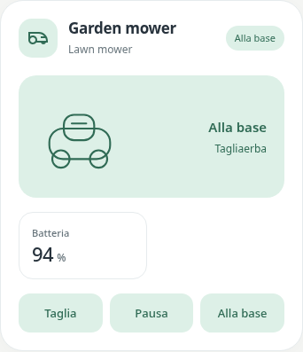

# Pastel Lawn Mower

[](https://my.home-assistant.io/redirect/hacs_repository/?owner=Angelofsin666&repository=pastel-ui&category=plugin)



## English

Pastel Lawn Mower now uses the same compact mint design as the Robot card: a line-drawn mower, live status, optional metric tiles and native mowing controls when supported by the selected entity. Its name, colour, sensors and additional controls are editable. The pictured “Garden mower” and all entity IDs are fictional demo data; choose your own mower in the visual editor.

Included in the single Pastel UI installation. [Install the suite](../installation.md) · [Configuration reference](../configuration.md) · [Migration](../migration.md)

### Example

All entity IDs below are fictional. Replace them with your own. The screenshot is a rendered demo, not evidence of compatibility with a particular brand.

Existing `mower_entity`, `battery_entity`, `area_entity`, `time_remaining_entity`, `blade_entity` and `zone_entity` settings are read automatically. Custom `image_url` is no longer displayed: the card uses the shared mower illustration. See [migration](../migration.md) if you rely on that image.

```yaml
type: custom:pastel-lawn-mower-card
title: Garden mower
entity: lawn_mower.demo
color: mint
metrics:
  battery: sensor.demo_mower_battery
```

## Italiano

Pastel Lawn Mower usa il design verde della card Robot: tagliaerba disegnato, stato aggiornato da Home Assistant, riquadri facoltativi per i sensori e comandi nativi quando disponibili. Nome, colore, sensori e controlli aggiuntivi si modificano nell’editor.

Inclusa nell’installazione unica di Pastel UI. [Installazione](../installation.md) · [Configurazione](../configuration.md) · [Migrazione](../migration.md)

L’esempio sopra usa soltanto entità fittizie: sostituiscile con le tue. L’immagine mostra la demo e non certifica la compatibilità con un marchio. Le vecchie associazioni vengono lette automaticamente; l’eventuale immagine `image_url` personalizzata non viene più mostrata. Consulta la [migrazione](../migration.md) se usi quell’immagine.
