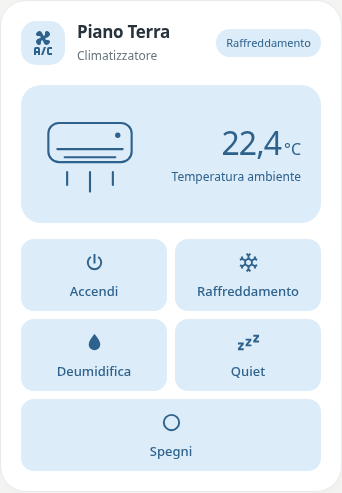

# Pastel Clima Script

`custom:pastel-script-climate-card` · Added in **v0.1.0-beta.6**.



## Italiano

Card per climatizzatori comandati da script, con lo stesso stile di Pastel Stufa. Non richiede un’entità `climate` e non sostituisce automaticamente Thermostat o le altre card.

### Configurazione dall’editor

1. Aggiorna Pastel UI da HACS, ricarica completamente l’interfaccia e scegli **Pastel Clima Script** in “Aggiungi card”.
2. Imposta il nome della card e scegli il **sensore di temperatura**. La ricerca propone sensori con classe temperatura o unità °C, °F o K. Puoi anche scrivere l’ID di un tuo sensore non classificato.
3. Scegli la **palette della card**.
4. Per ogni pulsante scegli lo **script**, modifica il **nome** e apri **Icona** per scegliere dalla griglia visiva. Puoi assegnare un colore diverso oppure lasciare “Come la card”.
5. Aggiungi, rimuovi o riordina i pulsanti con le frecce. Non c’è un numero fisso di funzioni.

La temperatura si aggiorna dal sensore scelto. I pulsanti avviano gli script tramite `script.turn_on`; la card non crea comandi nativi del climatizzatore e non modifica artificialmente la temperatura. Gli script devono già contenere le azioni necessarie per il dispositivo.

### Stato opzionale

Il fatto che uno script sia `off` non significa che il climatizzatore sia spento. Per questo, la card non usa gli script come stato del climatizzatore.

In **Altre opzioni** puoi associare una vera entità di stato (per esempio un `input_boolean` aggiornato dai tuoi script): comparirà il badge nell’intestazione. Ogni pulsante può avere un’**Entità funzione attiva** e lo stato atteso (predefinito `on`) per mostrare l’indicatore e l’evidenziazione. Senza associazione non viene inventato uno stato acceso/spento.

### Esempio YAML

Le entità sono fittizie; l’editor permette di configurare tutto questo senza YAML.

```yaml
type: custom:pastel-script-climate-card
title: Piano Terra
subtitle: Climatizzatore
color: blue
temperature_entity: sensor.example_temperature
buttons:
  - name: Accendi
    script: script.example_ac_on
    icon: mdi:power
  - name: Raffreddamento
    script: script.example_ac_cool
    icon: mdi:snowflake
  - name: Deumidifica
    script: script.example_ac_dry
    icon: mdi:water
  - name: Quiet
    script: script.example_ac_quiet
    icon: mdi:sleep
    color: lavender
  - name: Spegni
    script: script.example_ac_off
    icon: mdi:power-off
```

Campi opzionali: `state_entity` (badge di stato), `temperature_label`, `icon` (intestazione), `background_color`, `tint_color`, `accent_color`, `text_color`, `secondary_text_color`. Ogni pulsante supporta `name`, `script`, `icon`, `color`, `state_entity`, `active_state`, `active_label`, `inactive_label`. I sensori mancanti mostrano un trattino e gli script mancanti o non disponibili disabilitano il pulsante. Le palette e il tema Home Assistant determinano i colori; per uno sfondo bianco fisso puoi impostare `background_color: '#ffffff'` e scegliere testi scuri.

Le icone dell’editor comprendono accensione, spegnimento, freddo, caldo, deumidificazione, ventola, notte, quiet, automatico, eco, oscillazione, timer, turbo e aumenti/riduzioni. Il campo YAML `icon` accetta anche altre icone MDI disponibili in Home Assistant.

## English

A script-driven air-conditioner card matching Pastel Stove. No native `climate` entity is required. After updating Pastel UI through HACS and reloading the frontend, choose **Pastel Clima Script** from the card picker.

The simple visual editor provides the card name, a temperature-only sensor search, the shared Pastel palette, and a configurable list of buttons. Each button has a script-only search, editable name, visual icon grid, optional individual palette, and reorder/remove controls. You can add as many buttons as needed. The YAML example uses fictional entities.

Buttons call `script.turn_on` for the chosen script; scripts remain responsible for operating the device. Temperature follows the selected sensor without optimistic changes. Script running/idle states never imply HVAC power. An optional real `state_entity` supplies a header badge; each button can independently use a real state helper and `active_state` to show an active indicator. Missing readings show a dash and unavailable scripts disable their buttons.

Existing Thermostat, Climate and custom-action cards keep their current types and behavior. Validation uses simulated Home Assistant data; these tests have not operated a physical air conditioner.
