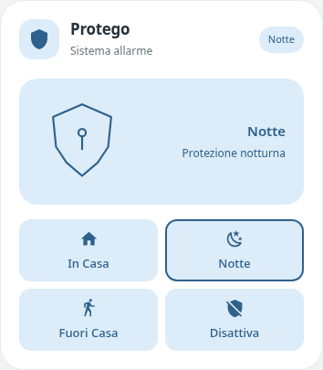
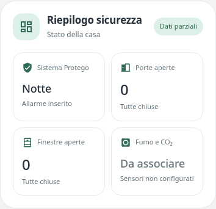

# Pastel Alarm & Riepilogo Sicurezza

Added in **v0.1.0-beta.7**.




## Italiano

Due card indipendenti nello stile Pastel. Dopo l’aggiornamento HACS ricarica completamente il frontend e cercale in “Aggiungi card”.

### Pastel Alarm

Tipo: `custom:pastel-alarm-card`. Il nome iniziale **Protego** è modificabile nel campo **Nome card**. Seleziona il pannello allarme; il suo stato viene mostrato nel badge, nell’illustrazione e nell’evidenziazione dei pulsanti.

Ogni pulsante ha nome, icona e palette personalizzabili, e un **Tipo di comando** indipendente:

- **Pannello allarme:** scegli una funzione nativa. La card verifica sia il servizio disponibile sia la capacità dichiarata dal pannello. Le funzioni non supportate restano disabilitate.
- **Script:** cerca o scrivi un’entità `script`. La card chiama `script.turn_on`; lo script deve già contenere le azioni del tuo sistema. Puoi usare esclusivamente script oppure mescolare le due modalità.

Il pannello rimane sempre la sorgente dello stato: inviare un comando non cambia artificialmente la modalità visualizzata. Puoi scegliere quale stato del pannello evidenzia ciascun pulsante. Aggiunta, rimozione e riordino sono disponibili nell’editor.

Se un comando nativo richiede un codice secondo gli attributi del pannello, viene mostrato un campo temporaneo. Il codice non viene salvato nella configurazione della card e viene rimosso dal campo al momento dell’invio o dell’annullamento. Gli script non ereditano questa richiesta: la loro logica rimane quella già configurata in Home Assistant.

Esempio con modalità miste ed entità fittizie:

```yaml
type: custom:pastel-alarm-card
title: Protego
subtitle: Sistema allarme
entity: alarm_control_panel.example
color: blue
buttons:
  - name: In Casa
    kind: script
    script: script.example_home
    state: armed_home
    icon: mdi:home
  - name: Notte
    kind: panel
    action: alarm_arm_night
    state: armed_night
    icon: mdi:weather-night
  - name: Fuori Casa
    kind: panel
    action: alarm_arm_away
    state: armed_away
    icon: mdi:walk
  - name: Disattiva
    kind: script
    script: script.example_disarm
    state: disarmed
    icon: mdi:shield-off
```

Per usare solo script, scegli `kind: script` su ogni pulsante e associa lo script corrispondente. `state` serve solo all’evidenziazione e non invia comandi. Non inserire codici o PIN nel file YAML della card.

### Pastel Security Overview

Tipo: `custom:pastel-security-card`. Titolo, sottotitolo, palette e tutti i riquadri sono personalizzabili. I tipi di riquadro sono:

- **Stato allarme:** seleziona un pannello `alarm_control_panel`.
- **Conteggio aperture:** seleziona un sensore/helper che fornisce il conteggio. I dati mancanti non vengono sostituiti da zero. Puoi personalizzare i testi di conteggio zero/positivo e leggere un attributo opzionale.
- **Sensori fumo, gas o segnalazione:** associa uno o più sensori reali. I suggerimenti includono le classi fumo, gas, CO, CO₂, sicurezza e problema; un sensore non classificato può essere inserito scrivendone l’ID. Con sensori binari si usano gli stati `on`/`off`, personalizzabili nelle opzioni. Con letture numeriche devi scegliere esplicitamente la soglia di segnalazione (valore ≥ soglia). La soglia è comune ai sensori numerici del riquadro: usa riquadri distinti per soglie o unità diverse.

Senza sensori il riquadro mostra **Da associare**; con dati mancanti mostra **Non disponibile**. Una lettura numerica senza soglia mostra **Imposta soglia**. **OK** appare solo quando tutti i sensori associati hanno dati interpretabili e non riportano una segnalazione secondo la configurazione. Una segnalazione reale prevale sui dati parziali.

Non viene assegnata automaticamente una soglia a CO₂ o altri gas; la card visualizza le letture e le regole configurate, senza certificare la sicurezza dell’ambiente.

```yaml
type: custom:pastel-security-card
title: Riepilogo sicurezza
subtitle: Stato della casa
color: mint
tiles:
  - kind: alarm
    name: Sistema allarme
    entity: alarm_control_panel.example
    icon: mdi:shield-check
  - kind: count
    name: Porte aperte
    entity: sensor.example_open_doors
    icon: mdi:door-open
  - kind: count
    name: Finestre aperte
    entity: sensor.example_open_windows
    icon: mdi:window-open
  - kind: detector
    name: Rilevatori fumo
    entities:
      - binary_sensor.example_smoke
    icon: mdi:smoke-detector
```

Le associazioni si fanno dall’editor; non sono richiesti stack-in-card, Mushroom, Button Card o card-mod. Le card esistenti non vengono sostituite automaticamente.

## English

**Pastel Alarm** (`custom:pastel-alarm-card`) provides an editable title (default Protego), a real alarm-panel state and arbitrary configurable buttons. Each button independently runs a supported native panel action or a chosen script. Names, icons, palettes, ordering and expected active states are editable. State is always read from the panel, never from the last command or the script’s running state. Native capabilities are checked against Home Assistant’s supported-feature bits and available services. Required native codes are requested transiently and never saved in card configuration.

**Pastel Security Overview** (`custom:pastel-security-card`) supports editable alarm, count and detector tiles. Binary detectors use configured active/normal states; numeric detectors require an explicit user-defined threshold. Separate tiles should be used for different thresholds/units. Missing data is not treated as zero or healthy; unconfigured detectors show “Da associare”. The card displays configured readings and rules rather than assigning environmental safety ratings.

Both cards preserve existing card types and have visual editors. Update Pastel UI through HACS (pre-releases enabled), reload the frontend, then add and configure the cards. Automated/browser validation uses simulated Home Assistant data; no live alarm was armed or disarmed by the tests.

Native API references: [Alarm control panel actions](https://www.home-assistant.io/integrations/alarm_control_panel/) and [Home Assistant feature constants](https://github.com/home-assistant/core/blob/dev/homeassistant/components/alarm_control_panel/const.py).
