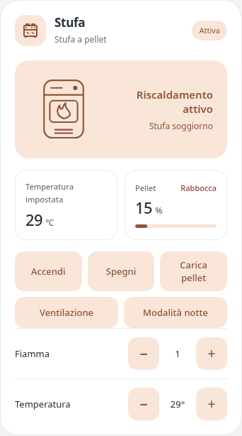

# Pastel pellet stove / Pellet Stove

`custom:pastel-stove-card` · Added in **v0.1.0-beta.3**, editor updated in **v0.1.0-beta.5**.



Display name: **Pastel pellet stove** since beta.8. The existing `custom:pastel-stove-card` type and saved settings are unchanged.

## Italiano

Una card nello stile delle altre Pastel, con illustrazione a contorno, palette condivisa, stati configurabili, sensore pellet e controlli comandati da script. Dopo l’aggiornamento HACS, ricarica il frontend e scegli **Pastel pellet stove** in “Aggiungi card”.

I campi entità consentono ricerca per nome e inserimento diretto dell’ID. I suggerimenti dei comandi mostrano solo script; il campo pellet accetta qualsiasi entità. Minimo e massimo dei controlli −/+ sono sempre liberi e opzionali.

L’editor visuale permette di:

- Cambiare titolo, sottotitolo, icona, palette, colori personalizzati e sfondo. Lo sfondo segue il tema Home Assistant; puoi fissarlo a `#ffffff`.
- Associare temperatura impostata, temperatura ambiente e percentuale pellet, anche da attributi. Le letture mancanti mostrano un trattino. La barra pellet è limitata a 0–100; la soglia di avviso è configurabile (20% predefinito).
- Aggiungere, rimuovere e riordinare tutti i pulsanti desiderati. Ogni pulsante può avviare uno script, un button o una scena; la disposizione va a capo automaticamente.
- Aggiungere controlli **−/+**: entità del valore, script meno, script più, nome, unità e limiti opzionali. I valori vengono riletti dalle entità, senza incrementi fittizi nella card.
- Definire stati in ordine di priorità. Una regola richiede tutte le condizioni (**E**) oppure almeno una (**O**). Puoi confrontare stato o attributo con “uguale” o “diverso”. Un timer attivo usato nelle condizioni viene mostrato automaticamente; puoi anche selezionarlo esplicitamente.

Gli script devono già gestire il dispositivo e aggiornare i suoi helper/sensori. La card non crea automazioni e non avvia comandi durante la configurazione. Il timer usa `finishes_at` di Home Assistant e non controlla la stufa. Se mancano dati necessari per una regola prioritaria, viene mostrato “Stato non disponibile”.

### Aiutante per ogni controllo −/+

In **Controlli −/+**, ogni sezione ha il campo **Aiutante del valore**: cerca o inserisci il counter/input_number modificato dai suoi script. I suggerimenti mostrano solo questi aiutanti numerici. Per esempio, seleziona `counter.example_flame` per Fiamma e `counter.example_temperature` per Temperatura.

Per il controllo della temperatura, attiva **Mostra questo aiutante anche come temperatura impostata**: il numero tra i tasti e il riquadro in alto leggono lo stesso aiutante. Solo un controllo può essere collegato al riquadro temperatura. Gli aggiornamenti arrivano da Home Assistant anche se il valore cambia tramite un’altra automazione. Gli script +/− restano indipendenti dall’aiutante visualizzato: devono già modificarlo.

In YAML l’aiutante si salva nel campo `entity` del controllo (compatibile con le configurazioni precedenti); il collegamento al riquadro usa `show_as_temperature: true`. Se nessun controllo è collegato, il riquadro continua a usare `temperature_entity`. Minimo e massimo restano facoltativi e non vengono preimpostati.

### Esempio

Le entità qui sotto sono fittizie. Sostituiscile oppure usa l’editor.

```yaml
type: custom:pastel-stove-card
title: Stufa
subtitle: Stufa a pellet
hero_caption: Soggiorno
color: peach
temperature_entity: counter.example_temperature
pellet_entity: sensor.example_pellet
pellet_warning_threshold: 20
fallback_label: Riscaldamento spento
fallback_badge: Spenta
controls:
  - name: Accendi
    entity: script.example_start
  - name: Spegni
    entity: script.example_stop
  - name: Carica pellet
    entity: script.example_load
steppers:
  - name: Fiamma
    entity: counter.example_flame
    minus:
      entity: script.example_flame_down
    plus:
      entity: script.example_flame_up
  - name: Temperatura
    entity: counter.example_temperature
    unit: °
    show_as_temperature: true
    minus:
      entity: script.example_temperature_down
    plus:
      entity: script.example_temperature_up
states:
  - id: starting
    label: In accensione…
    badge: Accensione
    match: all
    conditions:
      - entity: input_boolean.example_starting
        state: 'on'
      - entity: timer.example_starting
        state: active
  - id: loading
    label: Caricamento pellet…
    badge: Caricamento
    conditions:
      - entity: timer.example_loading
        state: active
  - id: stabilizing
    label: Stabilizzazione fiamma…
    badge: Stabilizzazione
    conditions:
      - entity: timer.example_stabilizing
        state: active
  - id: active
    label: Riscaldamento attivo
    badge: Attiva
    conditions:
      - entity: input_boolean.example_stove
        state: 'on'
  - id: cooling
    label: Raffreddamento in corso…
    badge: Raffreddamento
    conditions:
      - entity: input_boolean.example_cooling
        state: 'on'
```

### Opzioni avanzate

`tint_color`, `accent_color`, `background_color` sovrascrivono la palette. `text_color` e `secondary_text_color` permettono di adattare i testi a uno sfondo fisso. Ogni pulsante può avere `icon`, `color`, `background`. Gli script selezionati tramite `entity` vengono chiamati con `script.turn_on`. Per azioni personalizzate usa `action: dominio.servizio`, `entity`, `data` e/o `target`; dati e destinazioni complesse si configurano in YAML. Esempio:

```yaml
controls:
  - name: Programma personalizzato
    action: script.turn_on
    entity: script.example_programme
    data:
      variables:
        mode: eco
```

Ogni controllo −/+ supporta `name`, `entity`, `attribute`, `icon`, `unit`, `min`, `max`, `minus`, `plus`. I limiti disabilitano il tasto corrispondente quando il valore noto li raggiunge. Lascia i limiti vuoti se sono gestiti dagli script.

Per i sensori: `temperature_attribute`, `pellet_attribute`, `ambient_attribute`; etichette: `temperature_label`, `pellet_label`, `ambient_label`, `temperature_unit`, `pellet_warning_label`, `pellet_warning_color`. `entity` è un’entità di stato opzionale usata se nessuna regola corrisponde; senza questa entità viene usato `fallback_label`/`fallback_badge`. Gli `id` di stato `off` e `cooling` mostrano la fiamma spenta; il testo di riserva usa la fiamma spenta.

## English

A configurable pellet-stove card matching the shared Pastel theme. Install **v0.1.0-beta.8** through HACS (pre-releases enabled), reload the frontend and choose **Pastel pellet stove** in the card picker.

The visual editor supports appearance, arbitrary wrapping action buttons, independent minus/plus script controls, optional pellet and temperature readings, and ordered state rules with AND/OR conditions. Each stepper needs a value entity and separate minus/plus actions. Values update from Home Assistant, never from optimistic frontend increments. Scripts, integrations and helpers remain responsible for operating the stove and reporting its state.

The YAML example above uses fictional entities. `states` are evaluated in order; conditions support `entity`, optional `attribute`, `state`, and `operator: equals|not_equals`. The first matching rule wins. Missing data that could affect a higher-priority rule produces an unavailable status. Active timer conditions automatically expose the remaining time from Home Assistant’s `finishes_at`; `timer_entity` can override the timer shown. No command runs during setup.

`controls` has no fixed item limit. Each supports `name`, `icon`, `entity` (script/button/scene), or explicit `action`, `data`, `target`; optional `color` and `background` override the theme. `steppers` support `name`, `entity`, optional `attribute`, `icon`, `unit`, `min`, `max`, `minus`, `plus`. Palette overrides are `tint_color`, `accent_color`, `background_color`. Missing measurements show a dash; pellet bars clamp to 0–100 and warnings default to below 20%. Test coverage uses simulated Home Assistant data; physical stove operation has not been verified by these tests.

Since v0.1.0-beta.5 each stepper exposes a numeric-helper picker (counter/input_number suggestions) using its existing `entity` field. Enable `show_as_temperature: true` on one stepper to make the upper target-temperature reading use the very same source, overriding `temperature_entity` while linked. Both readings follow Home Assistant updates, including changes made outside this card; no optimistic increments are applied.
