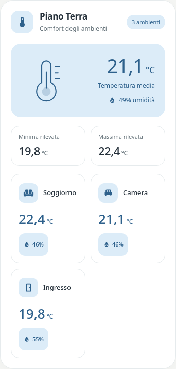

# Pastel Temperature



## English

A temperature overview redesigned to match Pastel Climate AC, Pellet Stove and Alarm: a shared card surface, a pastel thermometer panel, current minimum/maximum readings and a grid of room tiles. Each room supports a name, icon, color, temperature sensor and optional humidity sensor. The editor suggests temperature and humidity sensors separately and also accepts typed entity IDs. Rooms can be added, removed and reordered.

The existing `custom:pastel-temp-card` type and `rooms[].temp_entity` / `hum_entity` configuration remain valid. Temperature and humidity update from Home Assistant state changes. Unknown or unavailable temperatures display a dash and are excluded from the average; a partial-data message explains the coverage. Mixed °C, °F and K readings are converted to the selected display unit before averaging. With automatic units, the first recognized sensor unit is used.

Tap a room name for Home Assistant’s sensor details, or its humidity button for humidity details. The card does not change temperatures. Optional two-hour trends use Home Assistant history, refreshed at most every five minutes on state updates; if history is unavailable, trends are omitted. Current minimum/maximum values compare the rooms, not historical extrema. Humidity averages use the valid associated humidity sensors independently of temperature availability.

### Example

```yaml
type: custom:pastel-temp-card
title: Piano Terra
subtitle: Comfort degli ambienti
color: blue
show_trend: false
show_extremes: true
rooms:
  - name: Soggiorno
    icon: mdi:sofa
    temp_entity: sensor.living_temperature
    hum_entity: sensor.living_humidity
  - name: Camera
    icon: mdi:bed-double
    temp_entity: sensor.bedroom_temperature
  - name: Ingresso
    icon: mdi:door
    temp_entity: sensor.entrance_temperature
```

All IDs are examples. The editor exposes the shared palettes, per-room colors and optional `background_color`, `tint_color`, `accent_color`, `text_color`, `secondary_text_color` overrides. `unit` accepts `°C`, `°F`, or `K`; omit it for automatic selection. `summary_label`, `icon`, `show_extremes`, and `show_trend` customize the summary. `temp_min` and `temp_max` optionally add read-only scales. `alert_temp` and `alert_hum` optionally mark thresholds; all limits are user-defined and use the displayed unit. Legacy colors `indigo` and `cyan` map to the shared lavender and blue palettes.

**Pastel Temperature & Humidity has been removed.** To replace `custom:pastel-temp-humidity-card`, create a Pastel Temperature card and choose separate temperature and optional humidity sensor entities for each room. The retired card’s entity/attribute configuration is not automatically converted.

## Italiano

Ridisegnata con lo stile delle nuove card: termometro su pannello pastello, riepilogo e **riquadri degli ambienti**. Ogni riquadro ha nome, icona, colore, sensore temperatura e sensore umidità facoltativo. Puoi aggiungere, rimuovere e riordinare gli ambienti. Le ricerche propongono separatamente sensori di temperatura e umidità; puoi anche scrivere l’ID.

Le configurazioni esistenti di **Pastel Temperature** restano valide. Valori e medie seguono gli stati reali. I sensori non disponibili mostrano un trattino e vengono esclusi dalla media delle temperature. La media dell’umidità usa i sensori di umidità disponibili. Minima e massima confrontano le letture attuali degli ambienti, non lo storico. Tocca il nome dell’ambiente o il pulsante dell’umidità per aprire i dettagli del sensore. L’andamento facoltativo usa le ultime due ore di storico e viene omesso se lo storico non è disponibile.

Tutte le scale e soglie sono facoltative e liberamente configurabili, nell’unità visualizzata. Per sostituire **Pastel Temperature & Humidity**, ora rimossa, aggiungi Pastel Temperature e associa i sensori separati: non c’è conversione automatica dalla vecchia configurazione con attributi.
