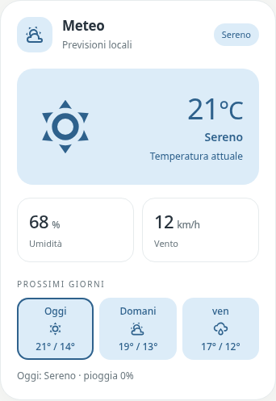

# Pastel Weather



`custom:pastel-weather-card` mostra il tempo attuale e, quando l'integrazione le fornisce, tre previsioni giornaliere. Si configura dall'editor visivo scegliendo un'entità `weather.*`. Il nome, il sottotitolo, la palette e i colori personalizzati sono modificabili.

```yaml
type: custom:pastel-weather-card
title: Meteo
subtitle: Previsioni locali
entity: weather.home
color: blue
show_details: true
show_forecast: true
```

Temperatura, umidità e vento provengono dagli attributi dell'entità. Le previsioni arrivano dall'abbonamento giornaliero di Home Assistant e si aggiornano quando cambia il fornitore; se non sono disponibili, la card lo segnala senza inventare valori. Toccando un giorno si vedono le condizioni e, se disponibile, la probabilità di pioggia.

The card reads the selected `weather.*` entity and subscribes to Home Assistant daily forecasts. Missing metrics stay hidden; a missing forecast is shown as unavailable.
